# Results Detailed: rd1-like Na/K Remodelling of the DSGC Model and Its Effect on DSI

## Summary

This task tested whether scaling the soma and AIS Na and K conductances of the Bed B DSGC model
reproduces the researcher's rd1 phenotype (`SomeResults.pdf`, panels A to D) and what it does to
signed direction selectivity. The result is mostly negative. Only the panel C sustained-current
ratio is reproduced (**1.631 to 1.698** on all 8 reference cells, every fit at the grid edge s_Na =
**0.25**); the Na transient only falls to **0.399 to 0.573** of WT-like instead of 0.25. The WT-like
reference cells are intrinsic pacemakers (median **73.5 Hz** at rest, no synapses), so panels A and
B have no valid WT baseline, and rd1-like cells never spike at the -10 mV threshold in any protocol,
so signed DSI is undefined for them (8 of 8 cells) and all four panel D predictions are disproved in
NEURON, whereas the toy model matches its 11 by-eye anchors by construction. All statistics are
exploratory (8 cells, 3 seeds, by-eye targets).

## Methodology

* **Machine**: local Windows 11 workstation, Intel Core i5-1145G7 @ 2.60 GHz (8 logical processors),
  15.7 GB RAM, no GPU, 7 parallel worker processes, NEURON 8.2.7. No remote machines.
* **Task start**: 2026-10-27T10:07:53Z. **Implementation step**: 2026-10-27T10:35:35Z to
  2026-10-27T16:31:14Z, a wall-clock runtime of **5 h 55 min 39 s** (5.93 h). Cost **$0**.
* **Reference cells (REQ-1)**: 8 LEGIT cells drawn with seed 131 from a 675-cell pool rebuilt from
  the four source dumps and checked against the t0121 parquet. Because earlier LEGIT status used
  process-randomised synapse placement, each of 28 screened candidates was re-evaluated with a
  deterministic placement (WT-like, 0 and 180 degrees, one seed) and kept only if its PD rate was
  within 25% of the recorded rate and signed DSI exceeded 0.3: **28 screened, 22 passed, 6
  rejected**. The cells are `t0114_seed7755_0256`, `t0114_seed7755_0114`, `t0114_seed7755_0349`,
  `t0106_seed44_0093`, `t0106_seed44_0074`, `t0115_seed9354_0032`, `t0115_seed9354_0060` and
  `t0112_seed77_0002` (`data/reference_cells.jsonl`, `data/reference_cell_screen.csv`).
* **Calibration targets**: read by eye from `SomeResults.pdf` and listed in `task_description.md`
  (sustained ratio about 1.7, transient ratio 0.25 assumed); the researcher supplied no exact
  traces, so no target was replaced.
* **Part 1, voltage clamp**: +100 mV soma step from -65 mV to +35 mV; 6 x 6 grid of s_Na (0.25,
  0.40, 0.55, 0.70, 0.85, 1.00) by s_K (1.0, 1.4, 1.8, 2.2, 2.6, 3.0) per cell (288 rows in
  `data/clamp_grid.csv`); per-cell fit by interpolation using clamp quantities only (a unit test
  checks that `code/calibration.py` reads no firing quantity). The Na transient was measured from
  the isolated soma+AIS Na channel current, because the K current hides the transient in the total
  current (a deviation from the plan).
* **Part 2, current clamp**: +60 pA, 500 ms step (pre-declared, out of sample), f-I curves over 12
  amplitudes (0 to 10,000 pA; amplitudes of 1000 pA and above were exploratory), spontaneous
  activity and a DC plus Gaussian-noise tonic bias tuned on rd1-like cells only. Spike threshold -10
  mV. Spontaneous runs used dt 0.05 ms.
* **Dendritic arm**: pre-declared trigger c fired, so Parts 1 to 3 were rerun scaling dendritic
  channels as well (reduced protocol, DSI on 5 cells).
* **Part 3, DSI**: HH on, 8 directions, fixed 1400 ms trials, 3 seeds, signed antipodal DSI = (PD -
  ND) / (PD + ND), set to `None` below 3 PD spikes; the synapse seed uses crc32. Only the FULL mode
  was run (no EPSP_PASSIVE / IPSP_PASSIVE trio; the existing Bed B evaluator has none).
* **Part 4, panel D**: a Naka-Rushton plus leaky-integrator toy model fitted to 11 by-eye anchors
  (tolerance 20%), then a NEURON sweep of PD synaptic strength u (0 to 100%) and a three-pulse drive
  on 3 cells, 3 seeds, with and without bias.

## Verification

* `uv run python -m arf.scripts.verificators.verify_task_results t0131_rd1_na_k_remodelling_dsgc_dsi`
  — final result recorded in the task step log (0 errors required before commit)
* `code/test_scaling_and_clamp.py` and `code/test_toy_model.py` — final run **8 passed** (two
  earlier runs had one failing test each, fixed before the final run;
  `logs/commands/041_20261027T162721Z_uv-run-pytest.json`)
* All numbers in this file were taken from `results/data_summary.json`, `results/metrics.json`,
  `results/costs.json`, `data/*.csv`, `data/*.json` and the answer asset.
* Registered metric `direction_selectivity_index` is reported as 8 explicit variants in
  `results/metrics.json`; undefined values are `null`, never 0.

## Results: Part 1 Voltage-Clamp Calibration

WT-like sustained outward current at +35 mV has median **482.6 nA** (range 347.0 to 680.1 nA), about
two orders of magnitude above the roughly 2 nA of panel C. WT-like Na transient (isolated channel
current) has median **-14.7 nA** (range -16.7 to -11.0 nA). The sustained ratio does not depend on
s_Na and rises with s_K in steps (1.14 at 1.4, 1.28 at 1.8, 1.42 at 2.2, about 1.56 at 2.6, about
1.70 at 3.0). An absolute step to +40 mV on 2 cells gave sustained currents of 468.6 and 479.1 nA,
similar to the delta step.

| Cell | s_Na | s_K | Sustained ratio | Na transient ratio | WT sustained (nA) | WT Na transient (nA) | rd1 sustained (nA) | rd1 Na transient (nA) |
| --- | --- | --- | --- | --- | --- | --- | --- | --- |
| t0114_seed7755_0256 | 0.25 | 2.99 | 1.698 | 0.450 | 447.3 | -16.09 | 759.6 | -7.24 |
| t0114_seed7755_0114 | 0.25 | 3.00 | 1.663 | 0.416 | 457.4 | -15.41 | 760.9 | -6.41 |
| t0114_seed7755_0349 | 0.25 | 3.00 | 1.631 | 0.452 | 497.9 | -16.19 | 812.2 | -7.32 |
| t0106_seed44_0093 | 0.25 | 2.54 | 1.686 | 0.399 | 467.3 | -13.97 | 787.9 | -5.57 |
| t0106_seed44_0074 | 0.25 | 2.87 | 1.685 | 0.405 | 513.7 | -13.61 | 865.3 | -5.51 |
| t0115_seed9354_0032 | 0.25 | 2.95 | 1.680 | 0.470 | 680.0 | -10.98 | 1142.5 | -5.16 |
| t0115_seed9354_0060 | 0.25 | 2.95 | 1.680 | 0.471 | 680.1 | -11.01 | 1142.5 | -5.19 |
| t0112_seed77_0002 | 0.25 | 2.36 | 1.668 | 0.573 | 347.0 | -16.68 | 578.6 | -9.55 |

Spread: s_Na is 0.25 (SD 0.0) for all 8 cells; s_K mean **2.834** (SD 0.243, range 2.364 to 3.0);
achieved sustained ratio mean **1.674** (SD 0.020); achieved transient ratio mean **0.455** (SD
0.056). All fits sit on the grid boundary (s_Na lower edge; s_K at or near the upper edge), so the
grid does not bracket the optimum. A plausible cause of the transient shortfall is the unscaled
persistent and resurgent Na channels, which was not tested. Sensitivity fits for transient targets
0.15 and 0.35 are in `data/fitted_scalings.json`.

## Results: Part 2 Current Clamp and Spontaneous Activity

* WT-like cells fire at rest: mean **40.75** spikes in 500 ms at 0 pA (7 of 8 cells firing) and
  **40.88** at +60 pA, so +60 pA changes nothing. WT-like spike peak is about **-4.4 mV**, FWHM
  **0.574 ms**, mean resting Vm **-62.4 mV**; panel B shows peaks of about 90 mV.
* rd1-like cells have **0 spikes** at the -10 mV threshold for every amplitude from 0 to 10,000 pA,
  with mean resting Vm **-55.5 mV**.
* The pre-declared collapse criterion gives **7 collapsed** and **1 uninformative** cell
  (`t0114_seed7755_0114` is silent in WT-like too). Because the WT-like count is identical at 0 and
  60 pA, what disappears is spontaneous firing, not evoked firing.
* Post-hoc check at a -30 mV threshold (not pre-declared, `data/cc_threshold_sensitivity.csv`):
  rd1-like cells `t0106_seed44_0093` (64 events at 0 pA) and `t0106_seed44_0074` (49 events at 0 pA)
  show attenuated spikes peaking near -21.8 and -29.5 mV, so the -10 mV count understates rd1-like
  activity (113 rd1-like and 327 WT-like events summed over cells at +60 pA).
* Without bias, WT-like mean spontaneous rate is **78.5 Hz** (median 73.5 Hz, ISI CV 0.058) and
  rd1-like is **0 Hz**, the opposite of panel A.
* The tuning grid (312 rows: pre-declared 0 to 50 pA DC with 0 to 10 pA noise plus an extended
  exploratory grid up to 6400 pA and 1600 pA noise, on 3 rd1-like tuning cells, noise seed 11) never
  gave an rd1-like mean rate above 0 Hz. Fallback combination (6400 pA DC, 0 pA noise) applied to
  all cells with noise seeds 11, 22, 33: WT-like **15.6 Hz**, rd1-like **0 Hz**.
* Bias form: DC `IClamp` at soma(0.5) for the whole run plus Gaussian white-noise `IClamp`
  (`Vector.play`, dt 0.1 ms, fixed seed per run); tuning rule: rd1-like only, closest mean rate to 7
  Hz among combinations with mean ISI CV above 0.5, then the same bias applied to WT-like.

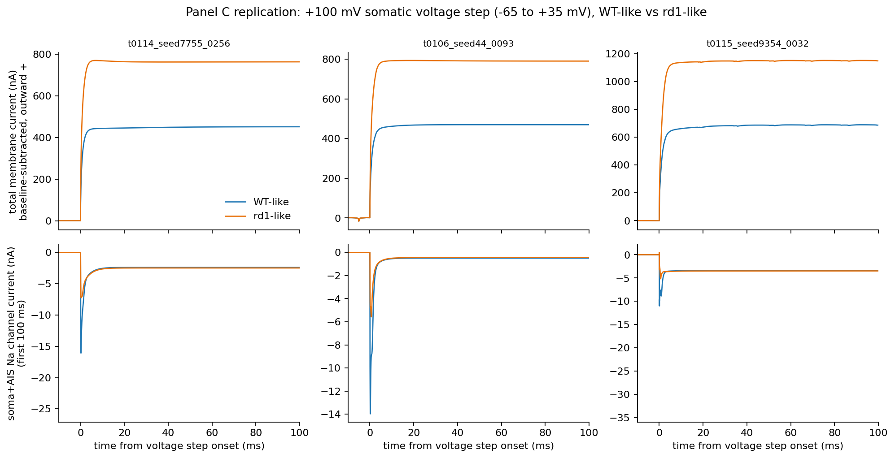

Panel C replication on 3 cells: the rd1-like total outward current is clearly larger than WT-like
(top row) and the isolated Na transient is smaller (bottom row), but the absolute scale is hundreds
of nA.

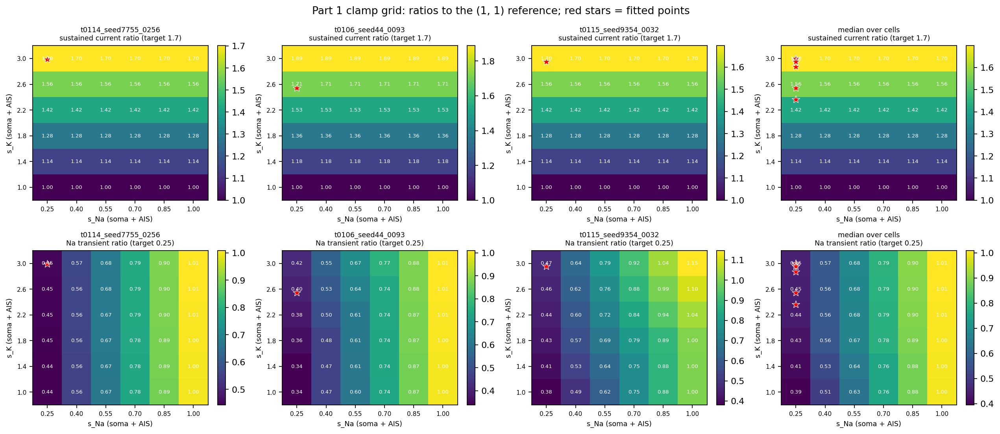

The 6 x 6 grid: the sustained ratio depends only on s_K, and the transient ratio only on s_Na; red
stars mark the fitted points, all at the s_Na = 0.25 edge.

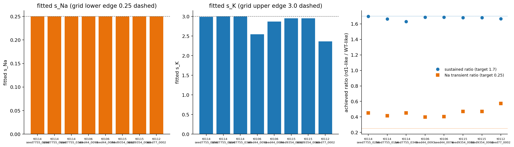

Fitted scalings per cell and achieved ratios against the 1.7 and 0.25 targets (transient never
reaches 0.25).

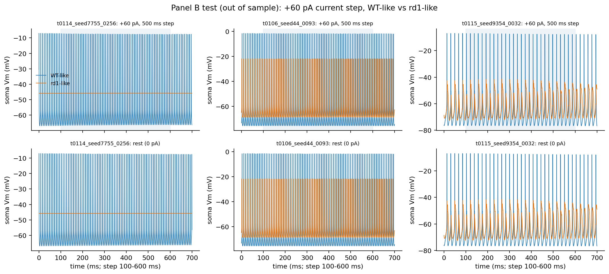

The +60 pA step (top) and rest (bottom) look identical for WT-like cells, which fire at rest;
rd1-like cells are silent except for the attenuated spikes of two cells.

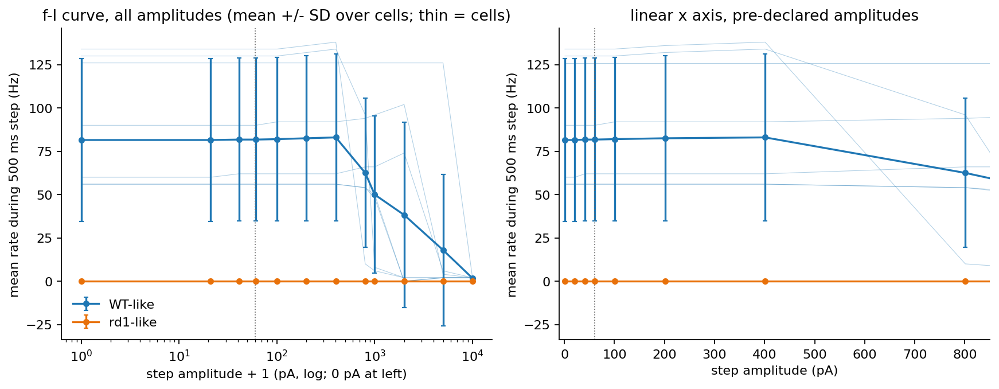

WT-like f-I is flat at about 82 Hz up to 400 pA and falls at 800 pA and above (depolarisation
block), rd1-like stays at 0 Hz across all amplitudes.

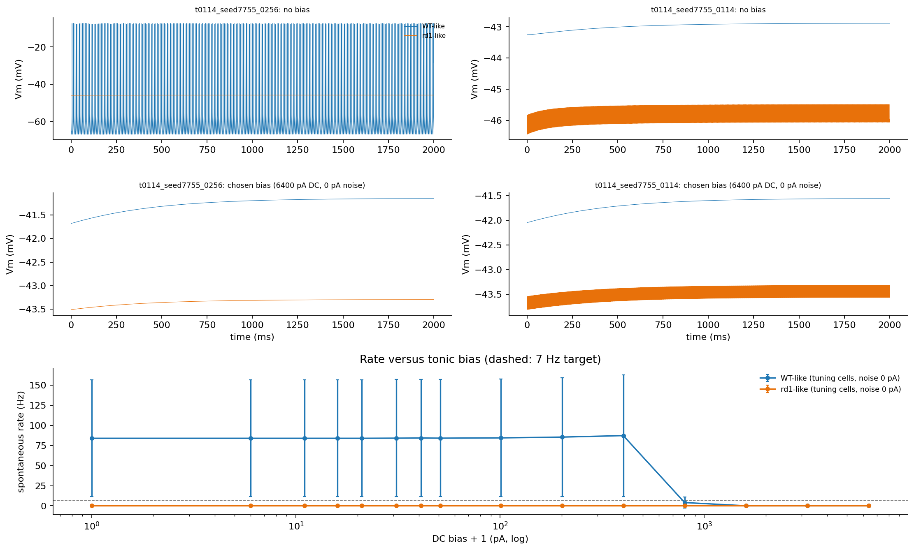

Spontaneous traces for 2 cells without bias and with the chosen 6400 pA bias, plus rate versus DC
bias: WT-like firing is abolished at large bias and rd1-like never fires.

## Results: Dendritic Arm

The pre-declared trigger c (rd1-like 4 to 10 Hz with ISI CV above 0.5 while WT-like stays below 1
Hz) fired; triggers a (sustained reach) and b (evoked firing not collapsed) did not
(`data/arm_decision.json`). The dendritic arm gave fits similar to the base arm (s_Na 0.25 on all 8
cells; s_K mean **2.825**, range 2.315 to 3.0; sustained ratio mean **1.668**; transient ratio mean
**0.465**, range 0.399 to 0.648). Collapse verdicts: 6 collapsed, 1 uninformative (and 1 other cell
not collapsed). rd1-like cells show mean **5.4 Hz** spontaneous activity over runs (median 0,
maximum 43 Hz from `t0112_seed77_0002`, ISI CV 0.005, i.e. regular, not irregular). The chosen bias
was 50 pA DC, 0 pA noise; no combination met the phenotype criteria. DSI on 5 cells: rd1-like
undefined on **5 of 5** cells, with and without bias.

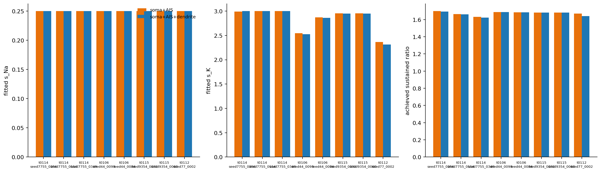

The two arms give almost identical scalings and sustained ratios per cell.

## Results: Part 3 Signed Direction Selectivity

| Condition | Median signed DSI | n defined | n undefined | Median PD rate (Hz) | Median ND rate (Hz) |
| --- | --- | --- | --- | --- | --- |
| WT-like | **0.874** | 8 | 0 | 86.7 | 3.1 |
| rd1-like | None | 0 | 8 | 0.0 | 0.0 |
| WT-like with bias (6400 pA) | 0.0 | 8 | 0 | 0.7 | 0.7 |
| rd1-like with bias (6400 pA) | 0.0 (one cell) | 1 | 7 | 0.0 | 0.0 |
| WT-like, dendritic arm (5 cells) | 0.971 | 5 | 0 | 107.6 | 1.2 |
| rd1-like, dendritic arm (5 cells) | None | 0 | 5 | 0.0 | 0.0 |
| WT-like with bias, dendritic arm | 0.965 | 5 | 0 | 107.4 | 1.4 |
| rd1-like with bias, dendritic arm | None | 0 | 5 | 0.0 | 0.0 |

* Paired PD-rate change rd1-like minus WT-like: median **-86.7 Hz** (Wilcoxon p = 0.0078, n = 8,
  bootstrap 95% CI -108.6 to -45.5 Hz). Signed DSI differences cannot be computed (0 pairs, 8
  dropped as undefined).
* WT-like with the 6400 pA bias has DSI 0.0 on 7 of 8 cells from 3 PD and 3 ND spikes (one onset
  spike per seed), which is an artefact, not tuning; `t0106_seed44_0093` is the exception (0.727).
* The one defined rd1-like-with-bias DSI (0.0, `t0112_seed77_0002`) is also 3 PD and 3 ND spikes.
* WT-like cells are pacemakers suppressed only near 180 and 225 degrees, so their DSI reflects
  direction-dependent inhibition cutting an intrinsic pacemaker rather than excitation-driven
  tuning.

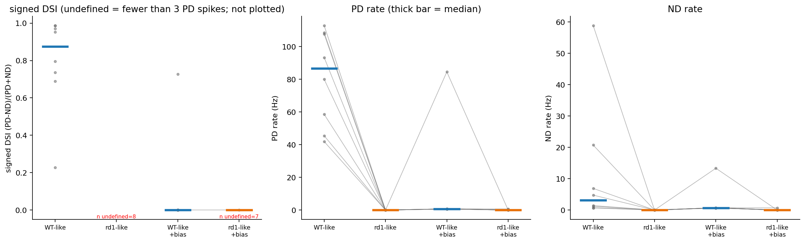

WT-like DSI is high (median 0.874) and rd1-like DSI is not plotted because it is undefined (n
undefined = 8 and 7 with bias); PD rate drops to 0 Hz for rd1-like.

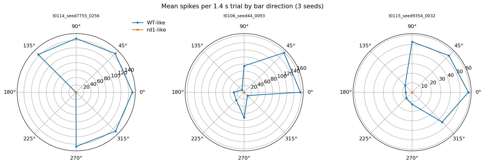

WT-like polar tuning is broad with a trough around 180 and 225 degrees; rd1-like is a point at the
origin (no spikes).

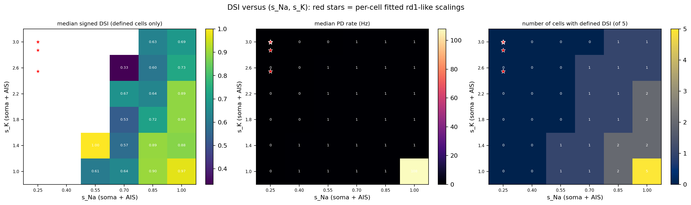

The heatmap (36 grid points, 5 cells, 2 directions, 2 seeds; `data/dsi_heatmap.csv`) has median PD
rate of 0 to 1 Hz everywhere except (s_Na, s_K) = (1, 1) (**107.9 Hz**, DSI **0.974**); **17 of 36**
grid points have no defined DSI, and all red fitted points lie in the undefined region.

## Results: Part 4 Panel D

* **Toy model** (Naka-Rushton plus leaky integrator; `data/toy_params.json`): matches **11 of 11**
  anchors within 20%, but it was fitted to them (largest errors: rd1 static u0 -16.1%, rd1
  min-between-peaks 13.9%, rd1 mean peak 13.5%). Its rd1-like peaks are broader (FWHM **126.7 ms**
  versus **64.5 ms**) because of saturation, while the fitted rd1-like time constant (**9.1 ms**) is
  shorter than the WT-like one (**16.6 ms**). Missing from the panel D description: equations, units
  of output and strength, normalisation, absolute strength of the pulse input (assumed 100), and
  time constants (`data/toy_anchor_check.json`).
* **NEURON sweep** (3 cells, 3 seeds): WT-like PD rate is 83.5 Hz at u = 0 and 87.5 Hz at u = 100
  (saturation index 1.0, flat in strength); rd1-like is 0 Hz at every u. With bias, WT-like falls
  from 38.6 to 28.7 Hz.
* **Three-pulse response**: WT-like PSTH is dominated by spontaneous rate and a start-up transient
  (first cell: distinctness 0.145, locking r = 0.120, baseline 101.3 Hz); rd1-like has no spikes, so
  baseline, locking and distinctness are undefined.
* **Verdicts** (`data/panel_d_verdicts.json`): flat saturated rd1 output **disproved** (flat at
  zero, not saturated), gradual WT growth **disproved** (median saturation index 1.0, 0 of 3 cells
  with index <= 0.6 and growth), elevated rd1 baseline **disproved**, rd1 temporal smearing
  **disproved**, with and without bias.

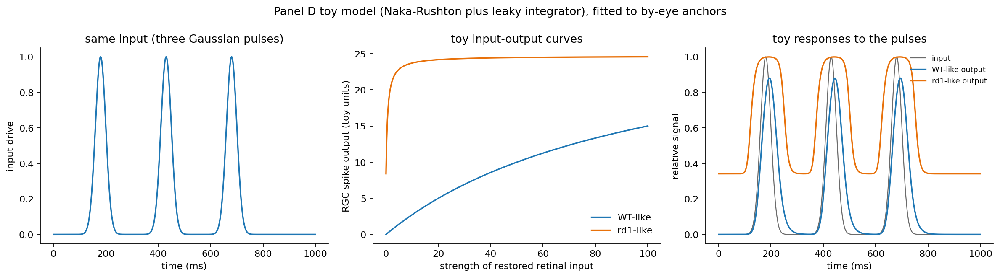

The toy model reproduces the by-eye features: a flat saturated rd1 curve (about 24 toy units), a
gradual WT curve (15 at u = 100), an elevated rd1 baseline (about 0.34) and broader rd1 peaks.

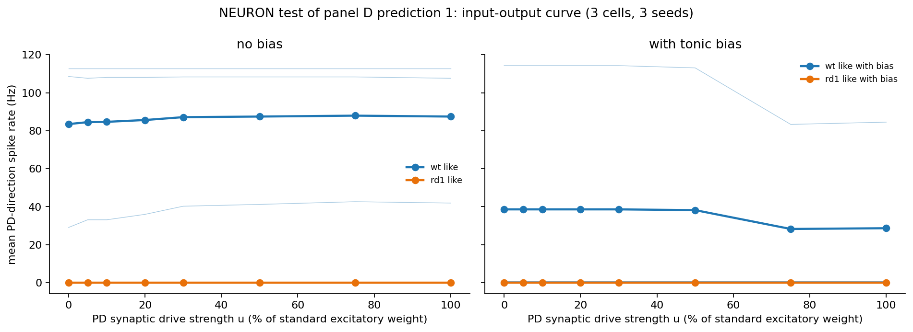

In NEURON the WT-like PD rate is nearly flat in u (and falls with the bias), and rd1-like is zero.

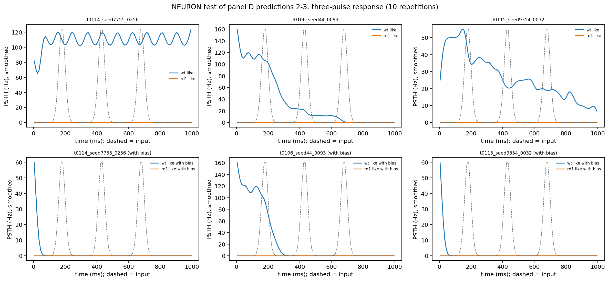

WT-like PSTHs follow the pacemaker and start-up transient, not the three input pulses; rd1-like
PSTHs are flat at zero.

## Metrics Tables

`results/metrics.json` holds the registered metric `direction_selectivity_index` (signed) as 8
variants.

| Variant | Arm | Tonic bias | n defined | n undefined | DSI |
| --- | --- | --- | --- | --- | --- |
| wt-like | soma_ais | no | 8 | 0 | **0.8741** |
| rd1-like | soma_ais | no | 0 | 8 | null |
| wt-like-with-bias | soma_ais | yes | 8 | 0 | 0.0 |
| rd1-like-with-bias | soma_ais | yes | 1 | 7 | 0.0 |
| wt-like-dendritic | soma_ais_dendrite | no | 5 | 0 | **0.9707** |
| rd1-like-dendritic | soma_ais_dendrite | no | 0 | 5 | null |
| wt-like-with-bias-dendritic | soma_ais_dendrite | yes | 5 | 0 | 0.9649 |
| rd1-like-with-bias-dendritic | soma_ais_dendrite | yes | 0 | 5 | null |

The `wt-like-with-bias` value of 0.0 and `rd1-like-with-bias` value of 0.0 are artefacts of 3 PD and
3 ND onset spikes (see Part 3), not evidence of lost selectivity.

## Examples

All examples are real rows from `data/` files; the "input" is the cell and protocol, the "output" is
the measured response, and the "expected" is the panel target.

* **Best case, clamp ratio** (`data/fitted_scalings.json`): `t0114_seed7755_0256`, s_Na 0.25, s_K
  2.990; expected sustained ratio 1.7, achieved **1.698**; WT 447.3 nA to rd1 759.6 nA; Na transient
  -16.09 nA to -7.24 nA (ratio 0.450, target 0.25). Shows the one reproduced result and the
  transient shortfall.
* **Worst case, clamp ratio** (`data/fitted_scalings.json`): `t0114_seed7755_0349`, s_K 3.0,
  achieved sustained ratio **1.631** (lowest of 8), still within the 0.15 tolerance.
* **Boundary case, transient** (`data/fitted_scalings.json`): `t0112_seed77_0002`, s_K 2.364,
  transient ratio **0.573** (the furthest from 0.25) with WT transient -16.68 nA and rd1 -9.55 nA.
* **WT-like vs rd1-like side by side at +60 pA** (`data/cc_step_summary.csv`): `t0114_seed7755_0256`
  WT-like 65 spikes (130 Hz, peak -7.5 mV, rest -59.7 mV) vs rd1-like 0 spikes (rest -45.8 mV);
  expected panel B: WT about 4 spikes, rd1 almost none. The WT-like count equals the 0 pA count
  (65), so the step has no effect.
* **Silent WT-like cell** (`data/cc_step_summary.csv`): `t0114_seed7755_0114` has 0 spikes in both
  WT-like and rd1-like at 0 and 60 pA (WT-like rest -43.3 mV), so the collapse verdict is
  "uninformative".
* **Random cell, attenuated spikes** (`data/cc_threshold_sensitivity.csv`): `t0106_seed44_0093`
  rd1-like at 60 pA has 0 events above -10 mV but 64 above -30 mV (peak -21.8 mV); the pre-declared
  threshold misses these spikes.
* **Boundary case, adaptation** (`data/cc_step_summary.csv`): `t0114_seed7755_0256` WT-like at 800
  pA 48 spikes (adaptation index 0.75), at 1000 pA 4 spikes, at 2000 pA 1 spike: depolarisation
  block, not the 4 adapting spikes of panel B.
* **Bias failure** (`data/bias_tuning.csv`): `t0114_seed7755_0256` rd1-like, s_Na 0.25, s_K 2.990,
  DC 0 to 15 pA with 0 to 10 pA noise: 0 spikes in every row, Vm about -45.85 mV; expected about 7
  Hz irregular firing.
* **Best-case DSI** (`data/dsi_results.csv`): `t0114_seed7755_0349` WT-like PD 108.6 Hz, ND 0.7 Hz,
  DSI **0.987**, rd1-like 0 and 0 spikes, DSI None.
* **Worst-case DSI** (`data/dsi_results.csv`): `t0114_seed7755_0114` WT-like PD 93.3 Hz, ND 58.8 Hz,
  DSI **0.227** (lowest of 8); direction means 130.7 spikes at 0 degrees vs 82.3 at 180 degrees.
* **Bias artefact side by side** (`data/dsi_results.csv`): `t0114_seed7755_0256` WT-like DSI 0.987
  (452 PD, 3 ND spikes) vs WT-like with 6400 pA bias DSI 0.0 (3 PD, 3 ND spikes); contrast with
  `t0106_seed44_0093` WT-like with bias PD 84.5 Hz, ND 13.3 Hz, DSI 0.727.
* **Heatmap contrast** (`data/dsi_heatmap.csv`): `t0114_seed7755_0256` at (s_Na, s_K) = (1, 1) PD
  302 spikes (107.9 Hz), DSI **0.987**; at (0.25, 1.0) 2 and 2 spikes, DSI undefined; at (0.25, 3.0)
  0 and 0 spikes.
* **Panel D sweep** (`data/panel_d_neuron_sweep.csv`): `t0106_seed44_0093` WT-like 158 spikes (112.9
  Hz) at both u = 0 and u = 100 (expected: growth to about 15 toy units); with bias, 160 spikes at u
  = 0 and mean 118.3 at u = 100 (counts 164, 32, 159, seed-dependent).
* **Panel D pulses** (`data/panel_d_neuron_pulses.csv`): `t0106_seed44_0093` WT-like distinctness
  0.641, locking r 0.073, baseline 61.4 Hz; rd1-like 0 spikes with all metrics undefined; the toy
  model gives rd1-like baseline 0.342 and WT-like locking r 0.862.
* **Toy anchor boundary** (`data/toy_anchor_check.json`): `rd1_static_u0` target 10.0, model 8.39
  (relative error -0.161, within the 20% tolerance but the largest).

Raw rows for the first reference cell (`data/dsi_results.csv`, columns: cell_id, condition, s_na,
s_k, i_bias_pa, pd_spikes, nd_spikes, pd_rate_hz, nd_rate_hz, dsi_signed; empty = undefined or not
applicable):

```text
t0114_seed7755_0256,wt_like,1.0,1.0,,452,3,107.61904761904762,0.7142857142857143,0.9868131868131869
t0114_seed7755_0256,rd1_like,0.25,2.990078125000001,,0,0,0.0,0.0,
t0114_seed7755_0256,wt_like_with_bias,1.0,1.0,6400.0,3,3,0.7142857142857143,0.7142857142857143,0.0
```

## Analysis

The clamp calibration works only partly and needs the extreme corner of the pre-declared grid. The
deeper problem is that the reference cells are intrinsic pacemakers whose excitatory synaptic input
is nearly irrelevant, so the WT-like model cell is not the researcher's near-silent WT cell and the
out-of-sample comparison cannot test evoked firing. Reducing Na by 4 times and raising K up to 3
times silences the cell, which removes spontaneous firing instead of producing it, so the direction
of the rd1 effect on spontaneous firing is opposite to the data. DSI of rd1-like cells cannot be
quantified; the only defensible statement is that this remodelling abolishes firing at the -10 mV
threshold in all conditions tested.

Key questions: Q1 partly (sustained ratio yes on all 8 cells, only at the grid edge; transient no);
Q2 no (the test is uninformative about evoked firing); Q3 no; Q4 undefined for rd1-like cells, no
dependence on bias could be shown; Q5 no for the compartmental model (the toy model reproduces its
own anchors).

## Limitations

* Calibration targets are by-eye values; the 0.25 transient ratio is an explicit assumption.
* The model's absolute current scale (hundreds of nA) is about 100-fold that of panel C, so pA-scale
  steps and biases barely perturb it; extended amplitudes (up to 10 nA) and biases (up to 6.4 nA)
  were exploratory.
* The soma clamp does not control the AIS and dendrites; the transient is a model-internal Na
  channel current from isolated soma+AIS, not a recorded one (plan deviation).
* The -10 mV threshold misses attenuated spikes; the -30 mV check is post hoc.
* Reference cells were screened with a deterministic placement different from earlier random
  placement; cell identities hold for this task only. 8 cells, 3 seeds, exploratory statistics.
* Single-cell model has no presynaptic network; the bias is only a surrogate. The dendritic arm used
  a reduced protocol (no extended amplitudes or bias grid, DSI on 5 cells).
* Further deviations: reference-cell screening step added; DSI silence rule (`None` below 3 PD
  spikes); 24 rather than 18 bias combinations applied; extra exploratory bias grids; dt 0.05 ms for
  spontaneous runs; crc32-based synapse seed; only FULL mode (no EPSP/IPSP trio); no
  `build_answer.py` script.
* The u = 100 versus Part 3 spike-count consistency check (reported in the answer asset as exact in
  9 of 9 trials) was ad hoc and its output was not saved, so it is not reproducible from the repo.
* `data/traces/` is about 68 MB in 194 files; `*_rows.jsonl` files contain stale rows and duplicate
  lines that the loaders deduplicate.
* The plan named `data/clamp_traces.npz`; clamp traces are instead stored as per-run files under
  `data/traces/` (`delta100_*.npz`).
* No rd1 or rd10 Na/K channel measurements exist in the corpus; the researcher's raw traces would
  replace the by-eye targets.

## Files Created

* `results/results_summary.md` and `results/results_detailed.md` — this report
* `results/metrics.json` — 8 variants of registered metric `direction_selectivity_index`
* `results/costs.json` — $0, `results/remote_machines_used.json` — empty list
* `results/data_summary.json` — collected statistics used for all numbers above
* `results/images/panel_c_clamp_traces.png`, `calibration_grid.png`, `fitted_scalings.png`,
  `current_clamp_traces.png`, `fi_curves.png`, `spontaneous_traces.png`, `dsi_by_condition.png`,
  `polar_tuning.png`, `dsi_heatmap.png`, `arm_comparison.png`, `panel_d_toy_model.png`,
  `panel_d_neuron_sweep.png`, `panel_d_neuron_pulses.png` — 13 charts
* `assets/answer/does-rd1-like-na-k-remodelling-of-the-dsgc-model-reproduce-the-rd1-phenotype-and-change-dsi/`
  — `details.json`, `short_answer.md`, `full_answer.md`
* `data/reference_cells.jsonl`, `data/reference_cell_screen.csv` — reference cells and screen
* `data/cell_params.jsonl`, `data/cell_params_dendritic.jsonl` — per-cell parameter dump
* `data/clamp_baseline.csv`, `data/clamp_grid.csv`, `data/clamp_grid_dendritic.csv`,
  `data/fitted_scalings.json`, `data/fitted_scalings_dendritic.json` — Part 1 tables and fits
* `data/cc_step_summary.csv`, `data/cc_threshold_sensitivity.csv`, `data/cc_collapse_verdict.json`,
  `data/fi_curves.csv` and dendritic variants — Part 2 current clamp
* `data/bias_tuning.csv`, `data/chosen_bias.json`, `data/spontaneous_summary.csv` and dendritic
  variants, `data/arm_decision.json` — bias tuning and arm decision
* `data/dsi_results.csv`, `data/dsi_stats.json`, `data/dsi_heatmap.csv`, `data/dsi_trials.jsonl` and
  dendritic variants — Part 3
* `data/toy_params.json`, `data/toy_anchor_check.json`, `data/panel_d_neuron_sweep.csv`,
  `data/panel_d_neuron_pulses.csv`, `data/panel_d_verdicts.json`, `data/panel_d_psth.npz` — Part 4
* `data/traces/` — 194 raw trace files (about 68 MB); `code/` — all scripts and 2 test files

## Task Requirement Coverage

Task name (verbatim from `task.json`): "rd1-like Na/K remodelling of the DSGC model and its effect
on DSI".

Short description (verbatim): "Calibrate soma/AIS gNa and gK scaling to rd1 vs WT clamp data, test
if it predicts rd1 firing, measure signed DSI, and reproduce or refute the panel-D toy model."

Long description (verbatim from `task_description.md`, operative parts):

> Reference cells: 5-10 LEGIT high-DSI cells drawn with a fixed seed from the t0121 pooled parquet
> (dependency `t0121_5seed_substrate_rate_canonical_report`). List the chosen cell IDs.
>
> Evaluator: reuse the signed antipodal DSI evaluator and `cell_params.jsonl` per-cell parameter
> dump from `t0129_t0126_signed_dsi_real_rates_1seed`.
>
> Conditions: WT-like (scale 1.0 on gNa and gK) and rd1-like (scaling from Part 1) for every
> reference cell.
>
> Part 1: 1. Replicate the +100 mV voltage step at the soma on each reference cell. 2. Sweep soma
> plus AIS gNa scale (0.25-1.0x) against gK scale (1-3x) on a grid of at least 6 x 6. 3. Choose the
> rd1-like scaling that matches the sustained-current ratio (~1.7x) and the reduced inward
> transient. Set the scaling from clamp data only; do not use any firing data. 4. Report the fitted
> scalings per cell and their spread across cells.
>
> Part 2: 1. With the Part 1 scalings, run the +60 pA, 500 ms step for WT-like and rd1-like cells.
> This is an out-of-sample test: report whether evoked firing collapses as in panel B. 2. For panel
> A, add a weak tonic bias current or noise at rest (exploratory; any form that works is acceptable,
> but state exactly what was used and how it was tuned). Check whether rd1-like cells fire
> irregularly at ~7 Hz while WT-like cells stay near silent. 3. Report f-I curves, spike amplitude,
> adaptation index and spontaneous rate for both conditions. 4. If soma and AIS scaling alone does
> not reproduce the phenotype, add a second arm that also scales dendritic channels and rerun Parts
> 1-2 for that arm.
>
> Part 3: 1. Run the standard protocol for WT-like and rd1-like cells: HH on, 8 directions, fixed
> 1400 ms trials. Use the EPSP_PASSIVE / IPSP_PASSIVE / FULL mode trio only where the existing
> protocol calls for it. 2. Report signed antipodal DSI = (PD - ND) / (PD + ND), PD rate and ND rate
> per cell and condition, with and without the tonic bias from Part 2. 3. Produce a
> DSI-versus-scaling heatmap over the Part 1 gNa x gK grid.
>
> Part 4: 1. Build the simple toy model (a rate or threshold-type model with WT-like and rd1-like
> parameters) matching this description and check that it reproduces panel D. If it cannot be
> reproduced from the description, state that and list what is missing. 2. Test both predictions in
> the NEURON model: sweep PD synaptic drive strength and compare the WT-like and rd1-like output
> curves; drive both with the three-pulse input and compare baseline, stimulus-locking and peak
> distinctness. 3. State for each prediction whether it is reproduced, partly reproduced or
> disproved.
>
> Key Questions: 1. Does Part 1 yield rd1-like scalings that reproduce the panel C current ratio on
> all reference cells? 2. Do those scalings, with no firing data in the fit, collapse evoked firing
> at +60 pA? 3. Can a tonic bias give ~7 Hz irregular spontaneous firing in rd1-like but not WT-like
> cells? 4. Does rd1-like remodelling raise, lower or leave unchanged signed DSI, and does the
> answer depend on the tonic bias? 5. Does the compartmental model reproduce the panel D saturation
> and temporal-smearing predictions?
>
> Expected Outputs: charts in `results/images/`, each embedded in `results_detailed.md` (panel C
> replication; gNa x gK calibration grid; current-clamp traces and f-I curves; signed DSI, PD rate
> and ND rate by condition plus the DSI-versus-scaling heatmap; panel D toy-model reproduction and
> NEURON sweep and three-pulse responses); one answer asset covering questions 1-5; per-cell
> parameter dump and results tables in `data/`; registered metric `direction_selectivity_index`
> (signed), reported per condition as variants.
>
> Compute and Budget: Local CPU only, no Vast.ai, no paid APIs. Estimated cost $0.

| ID | Status | Direct answer | Evidence |
| --- | --- | --- | --- |
| REQ-1 | Done | 8 LEGIT reference cells chosen with seed 131 (28 screened, 6 rejected): `t0114_seed7755_0256`, `t0114_seed7755_0114`, `t0114_seed7755_0349`, `t0106_seed44_0093`, `t0106_seed44_0074`, `t0115_seed9354_0032`, `t0115_seed9354_0060`, `t0112_seed77_0002` | `data/reference_cells.jsonl`, `data/reference_cell_screen.csv`, Methodology |
| REQ-2 | Done | Signed antipodal DSI evaluator and per-cell parameter dump protocol of t0129 reused (deterministic crc32 synapse seed is a deviation) | `code/evaluator.py`, `data/cell_params.jsonl` |
| REQ-3 | Done | WT-like (1.0, 1.0) and rd1-like (per-cell fitted scaling) run on every cell in Parts 1 to 3 | `data/dsi_results.csv`, `data/cc_step_summary.csv`, `data/fitted_scalings.json` |
| REQ-4 | Done | +100 mV soma step replicated on all 8 cells; WT-like sustained median 482.6 nA | `images/panel_c_clamp_traces.png`, `data/clamp_baseline.csv`, `data/traces/delta100_*.npz` |
| REQ-5 | Done | 6 x 6 grid (s_Na 0.25 to 1.0, s_K 1.0 to 3.0) on 8 cells, 288 rows | `data/clamp_grid.csv`, `images/calibration_grid.png` |
| REQ-6 | Partial | Scaling set from clamp data only (unit test for no firing quantities); sustained ratio 1.631 to 1.698 matched but only at the s_Na = 0.25 grid edge, transient 0.399 to 0.573 vs 0.25 target; transient measured from isolated Na channel current (deviation) | `data/fitted_scalings.json`, `code/calibration.py`, `code/test_scaling_and_clamp.py`, `images/fitted_scalings.png` |
| REQ-7 | Done | Fitted scalings per cell tabulated; s_K mean 2.834 (SD 0.243), s_Na 0.25 on all cells | Part 1 table, `images/fitted_scalings.png`, `data/fitted_scalings.json` |
| REQ-8 | Partial | Step run on all cells, but WT-like cells fire at rest (40.75 vs 40.88 mean spikes at 0 vs 60 pA), so the out-of-sample collapse test is uninformative: 7 collapsed, 1 uninformative | `data/cc_step_summary.csv`, `data/cc_collapse_verdict.json`, `images/current_clamp_traces.png` |
| REQ-9 | Partial | Bias form and tuning rule stated exactly, but no combination gave rd1-like firing (0 Hz everywhere; fallback 6400 pA gave WT-like 15.6 Hz, rd1-like 0 Hz), so the ~7 Hz irregular phenotype is not reproduced | `data/bias_tuning.csv`, `data/chosen_bias.json`, `images/spontaneous_traces.png` |
| REQ-10 | Partial | f-I curves, spike peak (WT-like about -4.4 mV), adaptation index and spontaneous rate (WT-like 78.5 Hz, rd1-like 0 Hz) reported, but rd1-like spike amplitude and adaptation are undefined (no spikes at -10 mV) | `data/fi_curves.csv`, `data/spontaneous_summary.csv`, `images/fi_curves.png` |
| REQ-11 | Done | Trigger c fired, dendritic arm run for Parts 1 to 3 (reduced protocol); same outcome, rd1-like DSI undefined on 5 of 5 cells | `data/arm_decision.json`, `data/fitted_scalings_dendritic.json`, `data/dsi_results_dendritic.csv`, `images/arm_comparison.png` |
| REQ-12 | Partial | 8 directions, 1400 ms, 3 seeds, FULL mode only (no EPSP/IPSP trio); WT-like median DSI 0.874, PD 86.7 Hz, ND 3.1 Hz; rd1-like DSI undefined on 8 of 8 with and without bias | `data/dsi_results.csv`, `data/dsi_stats.json`, `images/dsi_by_condition.png`, `images/polar_tuning.png` |
| REQ-13 | Done | Heatmap over the 6 x 6 grid on 5 cells (36 points, 17 with no defined DSI) | `data/dsi_heatmap.csv`, `images/dsi_heatmap.png` |
| REQ-14 | Done | Toy model fitted to 11 by-eye anchors, all within 20%; missing information listed (equations, units, normalisation, input strength, time constants) | `data/toy_params.json`, `data/toy_anchor_check.json`, `images/panel_d_toy_model.png` |
| REQ-15 | Done | NEURON sweep of PD strength u (0 to 100) and three-pulse drive on 3 cells, with and without bias | `data/panel_d_neuron_sweep.csv`, `data/panel_d_neuron_pulses.csv`, `images/panel_d_neuron_sweep.png`, `images/panel_d_neuron_pulses.png` |
| REQ-16 | Done | All four predictions disproved in NEURON, with and without bias | `data/panel_d_verdicts.json` |
| REQ-17 | Done | Q1 partly; Q2 no (uninformative); Q3 no; Q4 undefined for rd1-like, no bias dependence shown; Q5 no | `assets/answer/does-rd1-like-na-k-remodelling-of-the-dsgc-model-reproduce-the-rd1-phenotype-and-change-dsi/` |
| REQ-18 | Done | 8 explicit variants of `direction_selectivity_index`; undefined values stored as null | `results/metrics.json` |
| REQ-19 | Done | 13 charts in `results/images/`, all embedded above; per-cell parameter dump and tables in `data/` (the planned `data/clamp_traces.npz` is replaced by `data/traces/`) | `results/images/`, `data/` |
| REQ-20 | Done | Local CPU only, no remote machines, $0 | `results/costs.json`, `results/remote_machines_used.json` |
