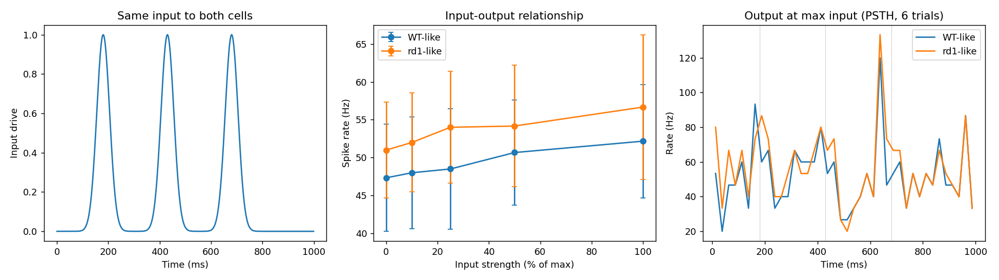
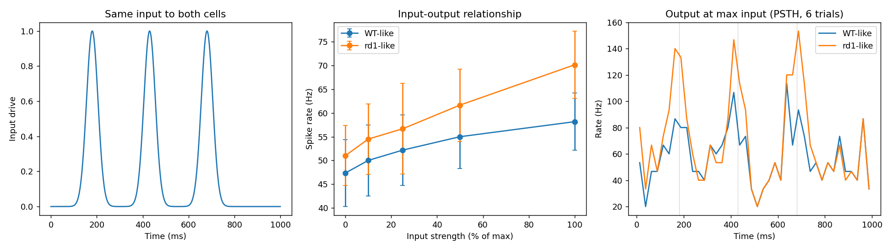

# rd1 Spontaneous Activity and Panel D Input: Exploratory Results

## Summary

Exploratory run on one reference cell (`t0106_seed44_0093`, index 3) of the t0131 model. **Correction
after recounting events with a -35 mV detector** (the original -10 mV count missed attenuated
spikes): with the shared Poisson background both cells fire about 1 event per background event,
**47.3 Hz** WT-like versus **51.0 Hz** rd1-like (+8%), so elevated rd1 spontaneous activity is
**not** reproduced; without any drive both are silent. Under the panel D pulses both cells give
graded, pulse-locked output and rd1-like has the **higher gain**: at the 400 Hz input **58.2 Hz**
(WT-like) versus **70.2 Hz** (rd1-like) at u = 100, in-pulse rate **78.3** versus **113.3 Hz**.
Panel D (rd1 flat and saturated, WT graded) is not reproduced. One cell, hand-tuned, not run through
the full ARF stages.

## Methodology

* Cell: t0131 reference cell index 3, 36.9 C, dt 0.05 ms, 150 ms settle, 1000 ms trials
* Soma-attached constant conductances (`ExpSyn`, tau 1e9 ms) for K2P-like (E -85 mV) and
  NALCN-like (E 0 mV) leaks; Poisson excitatory events (E 0 mV, tau 2 ms) at the soma
* Background: 50 Hz, 3 µS per event, same event times for WT-like and rd1-like per seed
* Input: three Gaussian pulses (180, 430, 680 ms, sigma 25 ms), extra events at 1 µS, peak rate
  100 Hz (weak run) or 400 Hz (`data/panel_d_strong400`), strengths 0, 10, 25, 50, 100, 6 seeds
* Scans: `data/screen`, `scan1` to `scan7` (single runs, one seed, 400 to 1500 ms)

## Results

* Pacemaker source (WT-like, 400 ms): baseline 122.5 Hz; `nart80` = 0 gives 0 Hz at -52 mV; Ih = 0
  gives 42.5 Hz; Kv7 x3, Ca-T = 0 and SK-AHP x4 change nothing
* `nart80` scan: WT-like silent at x0.1 (depolarised -52 mV), 73 to 130 Hz from x0.15; rd1-like
  0 Hz up to x4, then 84 to 94 Hz at x5 to x7 (no graded regime)
* NALCN-like leak on rd1-like (0.02 to 0.5 µS, with and without `nart80` x1 to x4): 0 spikes in
  all 11 runs, Vm drifts to -44 to -50 mV (Na inactivation block)
* K2P-like leak on WT-like: 0 Hz at 0.5 µS and above (Vm -71 to -78 mV); 122 Hz at 0.2 µS and below
* Poisson drive (50 Hz): rd1-like 12.0 Hz at 3 µS (seed 5), 10.7 Hz (seed 9), 20.7 Hz at 3.5 µS,
  0 to 1.3 Hz at 2 to 2.5 µS; WT-like with K leak 0 Hz at 2 µS, 2.7 Hz at 3 µS, 14 Hz at 4 µS
* Panel D, event counts at -35 mV (6 seeds, `data/panel_d_summary_events35.json`, weak input of
  100 Hz peak): WT-like **47.3 Hz** at u = 0 and **52.2 Hz** at u = 100; rd1-like **51.0** and
  **56.7 Hz**; locking ratio (in-pulse over between-pulse rate) at u = 100 **1.30** WT-like,
  **1.41** rd1-like
* Panel D, strong input (400 Hz peak, `data/panel_d_strong400_summary_events35.json`): WT-like
  **47.3 to 58.2 Hz**, rd1-like **51.0 to 70.2 Hz** over u = 0 to 100; locking ratio **1.58**
  WT-like, **2.19** rd1-like; no saturation of rd1-like output
* Retracted: the earlier -10 mV counts (WT-like 1.7 Hz, rd1-like 9.7 Hz at u = 0, "output falls with
  input", "depolarisation block in the pulses") were detector artefacts. The first-pass summaries
  `data/panel_d_summary.json` and `data/panel_d_strong400_summary.json` and the scan tables above
  (all counted at -10 mV) should be read with that in mind; K-leak silencing at rest (no events at
  -75 mV) is unaffected

(Original -10 mV version; superseded by the recounts below.)

Recounted figures (-35 mV events), weak and strong input:

## Limitations

* Both cells fire about once per 3 uS background event, so the "spontaneous" activity is
  event-driven, not intrinsic; no rd1-specific intrinsic pacemaking was obtained
* The -35 mV detector threshold was chosen after seeing the traces; not tested for sensitivity
* One reference cell, one background level, hand-tuned (K leak 1 µS, drive 3 µS at 50 Hz)
* The K2P-like leak and Poisson drive are added mechanisms, not part of the t0131 model
* Input was delivered at the soma only; dendritic input was not tested

## Files Created

* `code/lib.py`, `code/run_panel_d.py`, `code/analyse_panel_d.py`
* `data/screen`, `data/scan1` to `data/scan7`, `data/panel_d`, `data/panel_d_strong400`,
  `data/panel_d_summary.json`, `data/panel_d_strong400_summary.json`
* `results/images/panel_d_replication.png`, `panel_d_vm_traces.png`,
  `panel_d_strong400_replication.png`, `panel_d_strong400_vm_traces.png`
