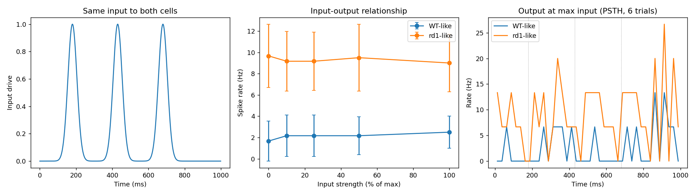
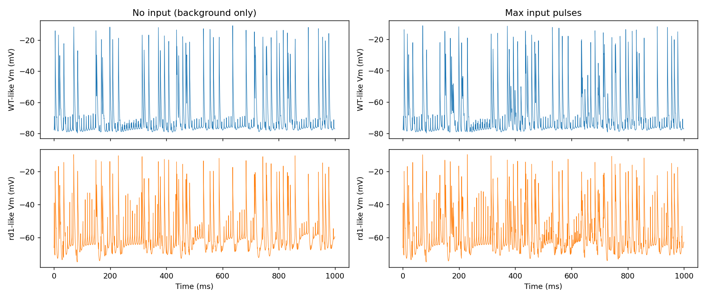

# rd1 Spontaneous Activity and Panel D Input: Exploratory Results

## Summary

Exploratory run on one reference cell (`t0106_seed44_0093`, index 3) of the t0131 model. WT-like
cells are intrinsic pacemakers (**122 to 130 Hz** at rest) driven by resurgent Na (`nart80`). A
K2P-like leak of **1 µS** silences WT-like (0 Hz at rest, Vm **-75 mV**). rd1-like cells (s_Na 0.25,
s_K 2.8, no K leak) are silent without drive and fire **9.7 Hz** under shared Poisson background
drive, versus **1.7 Hz** for WT-like. The panel D input does not reproduce panel D: output is flat.
This task has not been through the full ARF stages and used one cell only.

## Methodology

* Cell: t0131 reference cell index 3, 36.9 C, dt 0.05 ms, 150 ms settle, 1000 ms trials
* Soma-attached constant conductances (`ExpSyn`, tau 1e9 ms) for K2P-like (E -85 mV) and
  NALCN-like (E 0 mV) leaks; Poisson excitatory events (E 0 mV, tau 2 ms) at the soma
* Background: 50 Hz, 3 µS per event, same event times for WT-like and rd1-like per seed
* Input: three Gaussian pulses (180, 430, 680 ms, sigma 25 ms), extra events at 1 µS, peak rate
  100 Hz (weak run) or 400 Hz (`data/panel_d_strong400`), strengths 0, 10, 25, 50, 100, 6 seeds
* Scans: `data/screen`, `scan1` to `scan7` (single runs, one seed, 400 to 1500 ms)

## Results

* Pacemaker source (WT-like, 400 ms): baseline 122.5 Hz; `nart80` = 0 gives 0 Hz at -52 mV; Ih = 0
  gives 42.5 Hz; Kv7 x3, Ca-T = 0 and SK-AHP x4 change nothing
* `nart80` scan: WT-like silent at x0.1 (depolarised -52 mV), 73 to 130 Hz from x0.15; rd1-like
  0 Hz up to x4, then 84 to 94 Hz at x5 to x7 (no graded regime)
* NALCN-like leak on rd1-like (0.02 to 0.5 µS, with and without `nart80` x1 to x4): 0 spikes in
  all 11 runs, Vm drifts to -44 to -50 mV (Na inactivation block)
* K2P-like leak on WT-like: 0 Hz at 0.5 µS and above (Vm -71 to -78 mV); 122 Hz at 0.2 µS and below
* Poisson drive (50 Hz): rd1-like 12.0 Hz at 3 µS (seed 5), 10.7 Hz (seed 9), 20.7 Hz at 3.5 µS,
  0 to 1.3 Hz at 2 to 2.5 µS; WT-like with K leak 0 Hz at 2 µS, 2.7 Hz at 3 µS, 14 Hz at 4 µS
* Panel D weak input (6 seeds): rd1-like **9.7 Hz** at u = 0 and **9.0 Hz** at u = 100; WT-like
  **1.7 Hz** and **2.5 Hz**; in-pulse rate does not exceed between-pulse rate for rd1-like
  (6.1 vs 10.2 Hz at u = 100)
* Panel D strong input (400 Hz): both cells fall (WT-like 1.2 Hz, rd1-like 8.0 Hz at u = 100), the
  in-pulse rate drops to 0 to 0.6 Hz, which is depolarisation block

rd1-like output is elevated and flat across strengths, qualitatively like the panel D middle
panel for rd1, but WT-like output does not rise gradually and neither cell locks to the pulses.

## Limitations

* One reference cell, one background level, hand-tuned (K leak 1 µS, drive 3 µS at 50 Hz)
* The K2P-like leak and Poisson drive are added mechanisms, not part of the t0131 model
* Input at the soma drives depolarisation block; dendritic input was not tested
* The excitable window is narrow, so the input range that raises output is small

## Files Created

* `code/lib.py`, `code/run_panel_d.py`, `code/analyse_panel_d.py`
* `data/screen`, `data/scan1` to `data/scan7`, `data/panel_d`, `data/panel_d_strong400`,
  `data/panel_d_summary.json`, `data/panel_d_strong400_summary.json`
* `results/images/panel_d_replication.png`, `panel_d_vm_traces.png`,
  `panel_d_strong400_replication.png`, `panel_d_strong400_vm_traces.png`
