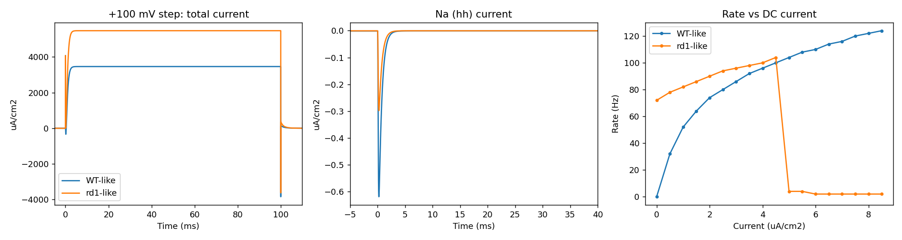
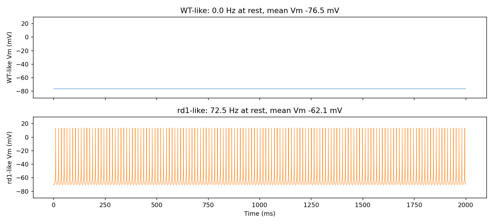
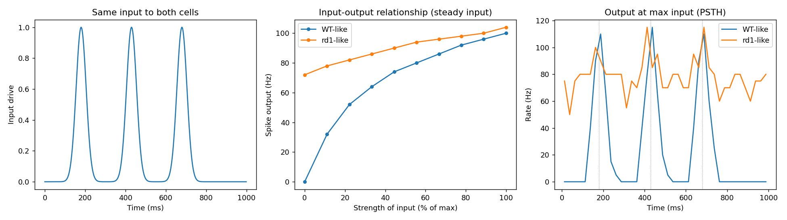
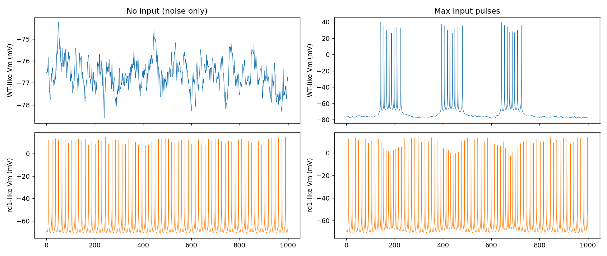

# Generic Neuron Reproduction of the rd1 Phenotype: Exploratory Results

## Summary

A single-compartment Hodgkin-Huxley neuron (NEURON `hh` plus persistent Na `napt80`, 12 C) reproduces
all three rd1 properties after a parameter search. Compared with WT-like, the rd1-like cell has
**0.48x** transient Na current, **1.58x** sustained current in a +100 mV step, and spontaneous
firing at **72.5 Hz** (WT-like **0 Hz**, Vm -76.5 mV). Under steady input WT-like output rises from
**0 to 100 Hz** and reaches the rd1-like level, while rd1-like output moves only from **72 to
104 Hz**. In the three-pulse test WT-like output is pulse-locked (about **110 Hz** peaks over a
silent baseline) and rd1-like output has an elevated baseline (about **75 Hz**) with weak locking.
The parameters were found by random search, not derived, and the rd1-like cell is a regular 72 Hz
clock, not the irregular 7 Hz of panel A.

## Methodology

* Cell: soma L = diam = 20 um, cm 1, `hh` (gnabar, gkbar, leak) plus `napt80` (persistent Na,
  half-activation -50 mV); NEURON 8.2.7, dt 0.025 ms, **12 C** (the classic HH model does not fire
  at 36 C)
* WT-like: gnabar 0.12, gkbar 0.036 S/cm2, leak 3.4e-4 S/cm2 with reversal -80 mV (K-leak-like),
  `napt80` 1.86e-3 S/cm2
* rd1-like: gnabar x0.481, gkbar x1.592, leak 6e-5 S/cm2 with reversal -77.1 mV (weak K leak),
  same `napt80`
* Search: `code/search.py` (900 sets, shared leak, none useful), `code/search.py` with separate
  leaks (900 sets), `code/search_fi.py` (1050 sets, f-I shape score); chosen set is the one with
  K x1.59 and Na x0.48 closest to the voltage-clamp ratios of the data
* Protocols in `code/run_final.py`: +100 mV step from -65 mV; 2 s at rest; DC f-I 0 to 8.5
  uA/cm2; three Gaussian current pulses (180, 430, 680 ms, sigma 25 ms, peak 4.5 uA/cm2) plus
  0.4 uA/cm2 noise, 8 trials per strength

## Results

* Voltage clamp: sustained current ratio rd1-like over WT-like **1.58**, Na transient ratio
  **0.48** (`data/final_results.json`); absolute values are densities of a very small soma, not
  comparable to panel C
* Spontaneous activity: WT-like **0 Hz**, rd1-like **72.5 Hz**, regular
* Steady input (f-I): WT-like 0, 32, 52, 74, 96, 100 Hz at 0, 0.5, 1, 2, 4, 4.5 uA/cm2; rd1-like
  72, 78, 82, 90, 100, 104 Hz at the same values
* rd1-like depolarisation block: rate drops to **4 Hz** at 5 uA/cm2 and above, so the usable range
  ends at 4.5 uA/cm2; WT-like keeps rising to 124 Hz at 8.5 uA/cm2
* Pulse protocol, mean spikes per second (8 trials): WT-like 0.0, 2.8, 10.1, 17.1, 21.0, 24.4 at
  u = 0, 10, 25, 50, 75, 100; rd1-like 72.4, 73.1, 74.2, 76.1, 77.9, 78.8

Left and middle: rd1-like has a larger sustained outward current and a smaller Na transient. Right:
rd1-like starts high, rises slowly, then collapses by block above 4.5 uA/cm2.

WT-like is silent at -76.5 mV; rd1-like fires regularly.

## Limitations

* The rd1-like cell is not saturated in the strict sense: it still rises by 40 percent over the
  usable range, then fails by depolarisation block (an artefact, not saturation)
* 72 Hz and regular firing versus about 7 Hz and irregular in panel A; the persistent Na pacemaker
  with weak K leak sets a high, clock-like rate
* Differences between the cells are Na, K and also the K-leak (WT-like leak 5.7x larger, more
  hyperpolarised), a third change that the voltage-clamp data does not constrain
* The classic HH model at 12 C, one parameter set from a random search, not tested for robustness
* Temperature and absolute units are not comparable with the retinal ganglion cell data

## Files Created

* `code/model.py`, `code/search.py`, `code/search_fi.py`, `code/run_final.py`
* `data/final_results.json`, `data/final_results_imax4.json`, `data/search*.jsonl`,
  `data/fi_search_*.jsonl`, `data/old/`
* `results/images/voltage_clamp_and_fi.png`, `spontaneous_activity.png`,
  `panel_d_generic_neuron.png`, `panel_d_generic_vm_traces.png`
